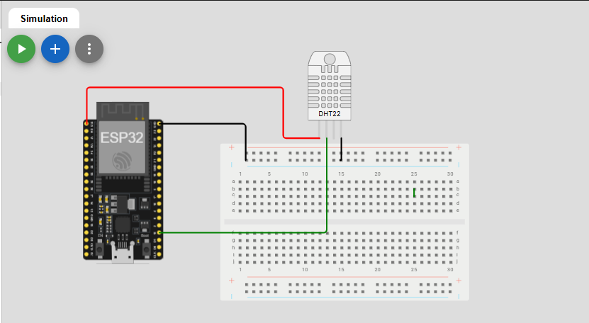
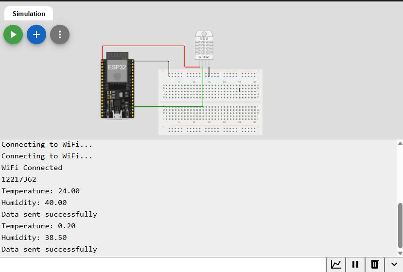
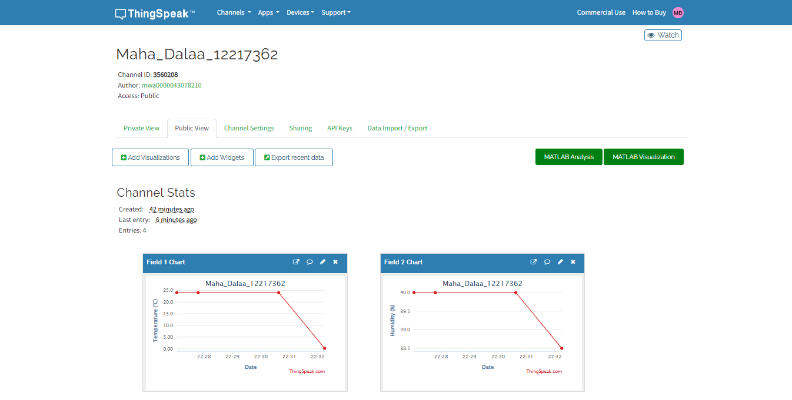

# ESP32 Temperature and Humidity Monitoring System

## Project Overview

This project monitors temperature and humidity using an ESP32 microcontroller and a DHT22 sensor. The collected readings are sent to ThingSpeak over Wi-Fi and displayed using real-time charts.

The project was implemented and tested using the Wokwi online simulator.

## Objectives

- Read temperature and humidity values from a DHT22 sensor.
- Connect the ESP32 to Wi-Fi.
- Send sensor readings to ThingSpeak.
- Display temperature and humidity data using ThingSpeak charts.
- Monitor sensor readings through the Serial Monitor.

## Components

- ESP32 DevKit v1
- DHT22 Temperature and Humidity Sensor
- Wokwi Simulator
- ThingSpeak IoT Platform

## Circuit Connections

| DHT22 Pin | ESP32 Pin |
|---|---|
| VCC | 3V3 |
| DATA | GPIO 15 |
| GND | GND |
| NC | Not Connected |

## ThingSpeak Configuration

The ThingSpeak channel contains two fields:

- **Field 1:** Temperature (°C)
- **Field 2:** Humidity (%)

The channel is configured with Public View enabled so the charts can be viewed publicly.

**Public ThingSpeak Channel:**  
[https://thingspeak.mathworks.com/channels/3560208]

## Implementation

The ESP32 performs the following steps:

1. Initializes the DHT22 sensor.
2. Connects to the Wokwi Wi-Fi network.
3. Reads temperature and humidity values.
4. Sends the readings to ThingSpeak using the ThingSpeak library.
5. Prints the readings and sending status to the Serial Monitor.
6. Repeats the process every 20 seconds.

The University ID is also printed in the Serial Monitor.

## Libraries Used

- WiFi
- ThingSpeak
- DHT sensor library
- Adafruit Unified Sensor

## Simulation

The project was implemented and tested using Wokwi.

**Wokwi Project Link:**  
[https://wokwi.com/projects/479337819042684929]

## Screenshots

### 1. Wokwi Circuit

### 2. Serial Monitor

### 3. ThingSpeak Charts

## Project Status

**Completed and successfully tested.**

The ESP32 successfully reads temperature and humidity values from the DHT22 sensor and sends them to ThingSpeak, where the data is displayed in charts.
